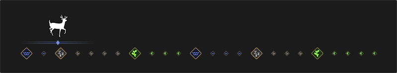
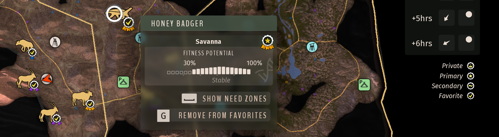
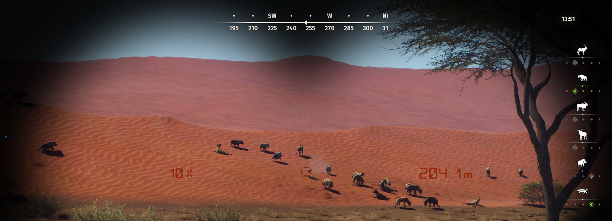

# Herd Tracker — Way of the Hunter Mod

By Mahpella

Follow favorite species' daily schedules in a dedicated HUD widget for Way of the Hunter and keep favorite herds easy to find on the map.

## Overview

Following several herds means repeatedly opening the map and looking up when each species feeds, drinks, or rests. It is easy to lose track of the next useful hunting window. Herd Tracker puts those schedules directly in the HUD and keeps important herds clearly marked on the map. One row per favorite species makes it easier to plan your next stop while continuing the hunt.

## Download & Install

Download the mod from my website: [https://mahpella.com/games/way-of-the-hunter/mods/favorite-herd](https://mahpella.com/games/way-of-the-hunter/mods/favorite-herd)

**Installation guide**

### Step 1. Create a backup (optional)

If you wish, copy the Saved folder to another location:  
**Win + R → %LOCALAPPDATA%\WayOfTheHunter**

### Step 2. Open the game folder

Close the game. In Steam, browse the local files for Way of the Hunter and open:  
**WayOfTheHunter\Content\Paks**

### Step 3. Install the mod

Extract the archive and copy all **.pak files into the Paks folder**, replacing older versions if necessary.  
Launch the game and load your save.

This archive requires both `WOTH_MapInterface_P.pak` and `WOTH_HerdFavorites_1_P.pak`. Remove the old combined `WOTH_NeedZoneClarity_P.pak` and obsolete `WOTH_HerdFavorites_P.pak` if present. When also using Better Need Zones, keep one matching copy of `WOTH_MapInterface_P.pak` from the 0.2.2 split build. Mod Settings Core is not required for this mod.

## How to Use

- Open the map and select a herd's information panel.
- Click Add to Favorites or press G; use the same action again to remove it.

- Follow the HUD schedule: gray for resting, green for feeding, and blue for drinking.
- Each favorite species appears once, even if you favorite several of its herds.

- Up to nine rows are visible; additional species wait in a queue. Removing a species frees a row, and adding it again places it at the end.
- Find favorite herds by their yellow check and full animal icon at any map zoom.
- Favorites and HUD order are saved for the current map and game mode. The widget shows the standard species schedule.

## Feedback

I create mods that add useful improvements to Way of the Hunter. Many ideas come up while playing, when I notice a way to make familiar mechanics a little more convenient.

If you find a bug, have suggestions for improving this mod, or have ideas for new mods, I would love to hear from you.

More useful mods: [https://mahpella.com](https://mahpella.com)

If you can spare a small donation to support the creation of new mods, I would appreciate it.

Support new mods: [https://buymeacoffee.com/mahpella](https://buymeacoffee.com/mahpella)
